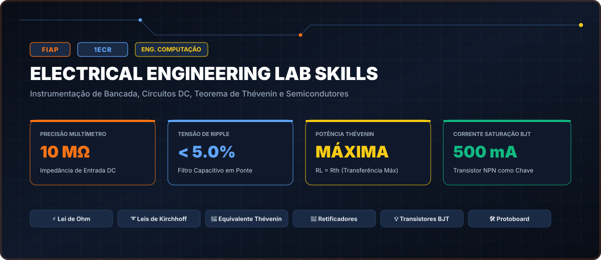

# FIAP • Electrical Engineering Lab Skills (Turma 1ECR • 2022)

> **Engenharia da Computação — FIAP (Faculdade de Informática e Administração Paulista)**  
> **Turma:** 1ECR • Ano Letivo 2022  
> **Portal Interativo GitHub Pages:** [https://guimemee.github.io/fiap-electrical-engineering-lab-skills/](https://guimemee.github.io/fiap-electrical-engineering-lab-skills/)

---

## 📋 Sumário Executivo

Este repositório consolida o acervo acadêmico integral e os projetos práticos de engenharia da disciplina **Electrical Engineering Lab Skills**, contemplando:
1. **6 Checkpoints Oficiais (2022):** Enunciados integrais originais, memórias de cálculo passo a passo no padrão Symbolab e cadernos Jupyter (`.ipynb`) com gráficos executáveis.
2. **Apostilas e Teoria:** Slides e referências didáticas.
3. **Exercícios de Laboratório:** Guias práticos e simulações.
4. **Global Solution:** Projetos integradores do semestre.

---

## 🎯 6 Checkpoints Oficiais

- **Checkpoint 1: Efeito de Carga do Multímetro em Circuitos de Alta Impedância:** [`01_Checkpoints_2022/Checkpoint_1_Instrumentacao_e_Protoboard/Resolucao_Calculos.ipynb`](01_Checkpoints_2022/Checkpoint_1_Instrumentacao_e_Protoboard/Resolucao_Calculos.ipynb)
- **Checkpoint 2: Análise da Lei de Ohm e Potência em Associação Mista:** [`01_Checkpoints_2022/Checkpoint_2_Lei_de_Ohm_e_Associacao_Resistores/Resolucao_Calculos.ipynb`](01_Checkpoints_2022/Checkpoint_2_Lei_de_Ohm_e_Associacao_Resistores/Resolucao_Calculos.ipynb)
- **Checkpoint 3: Resolução de Malhas de Kirchhoff por Álgebra Matricial:** [`01_Checkpoints_2022/Checkpoint_3_Leis_de_Kirchhoff_Malhas_e_Nos/Resolucao_Calculos.ipynb`](01_Checkpoints_2022/Checkpoint_3_Leis_de_Kirchhoff_Malhas_e_Nos/Resolucao_Calculos.ipynb)
- **Checkpoint 4: Teorema da Máxima Transferência de Potência (Thévenin):** [`01_Checkpoints_2022/Checkpoint_4_Circuitos_Divisores_e_Teoremas/Resolucao_Calculos.ipynb`](01_Checkpoints_2022/Checkpoint_4_Circuitos_Divisores_e_Teoremas/Resolucao_Calculos.ipynb)
- **Checkpoint 5: Dimensionamento de Retificador em Ponte e Filtro Capacitivo:** [`01_Checkpoints_2022/Checkpoint_5_Diodos_Retificacao_e_Filtros/Resolucao_Calculos.ipynb`](01_Checkpoints_2022/Checkpoint_5_Diodos_Retificacao_e_Filtros/Resolucao_Calculos.ipynb)
- **Checkpoint 6: Dimensionamento de Transistor BJT NPN como Chave Digital:** [`01_Checkpoints_2022/Checkpoint_6_Transistores_BJT_Chaveamento_Cargas/Resolucao_Calculos.ipynb`](01_Checkpoints_2022/Checkpoint_6_Transistores_BJT_Chaveamento_Cargas/Resolucao_Calculos.ipynb)

---

## 🏛️ Créditos e Rastreabilidade
- **Instituição:** FIAP
- **Curso:** Engenharia da Computação
- **Turma:** 1ECR • 2022
- **Aluno:** Guilherme Macario da Silva
